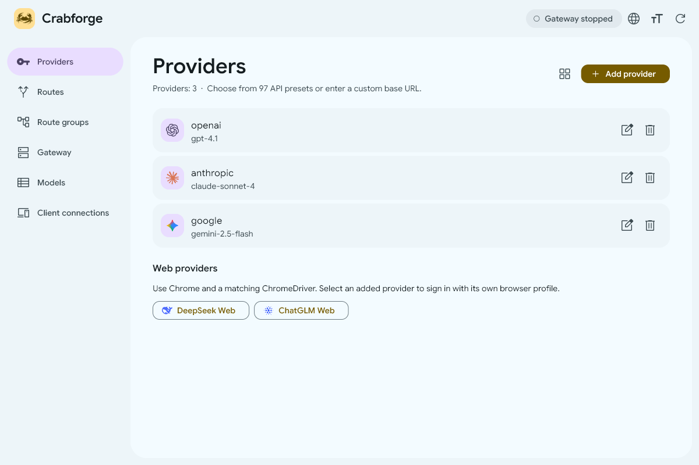
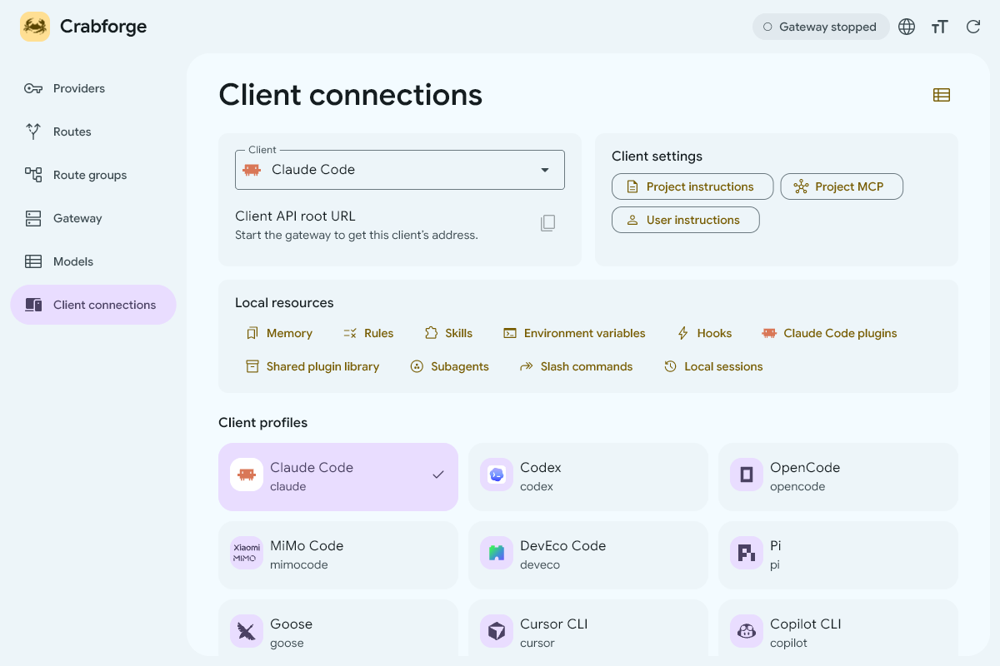
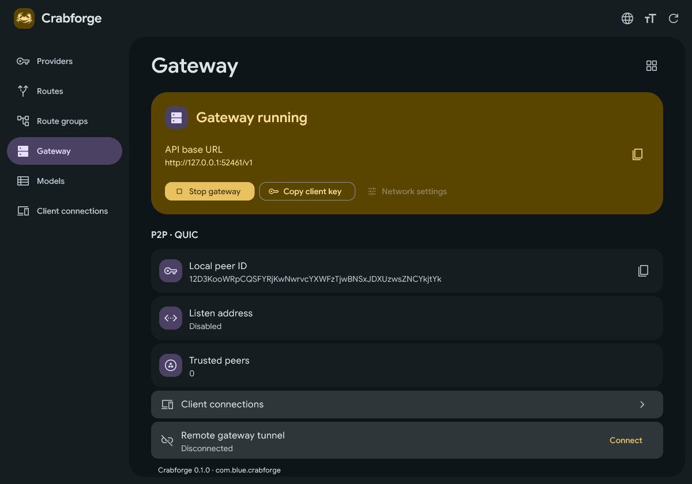

<p align="center"></p>

<h1 align="center">Crabforge</h1>

<p align="center">A local model gateway and Windows desktop console for AI clients.</p>

<p align="center">
  <a href="https://github.com/blueokanna/Crabforge/releases/latest">Download for Windows x64</a> ·
  <a href="docs/windows-release.en.md">Verify the download</a> ·
  <a href="README.zh-CN.md">简体中文</a>
</p>



*Screenshots show the current Windows source build with sample providers and models. The Windows `v0.1.0` download uses the earlier desktop layout.*

Configure upstream models in **Providers**, publish a stable model ID with **Route groups**, and inspect the gateway’s attempts in **Routes**. Clients connect to a single local gateway endpoint while you manage upstream connections in Crabforge. The Flutter desktop and the CLI use the same Rust core and configuration.

## Get started

1. Download the Windows x64 ZIP and its `.sha256` file from the same release. Follow the verification guide, extract the entire ZIP, and run `desktop\crabforge.exe`. Keep the neighboring DLLs and `data` directory in place. [Releases](https://github.com/blueokanna/Crabforge/releases) · [Verification guide](docs/windows-release.en.md)
2. Make the upstream API key available to the process that launches Crabforge. In **Providers → Add provider**, choose a preset or enter your API endpoint. Fill in **API key environment variable** with the variable name and select or enter at least one model.
3. In **Gateway**, select **Start gateway**, then **Copy client key**. For an OpenAI-compatible client, use `http://127.0.0.1:3425/v1` unless you changed the listen address. Use the copied client key and a model ID from **Models**.

The ZIP also contains `crabforge-cli.exe` and `carbforge-cli.exe`. They expose the same commands. To run the gateway in a terminal, use `./crabforge-cli.exe serve` with the upstream credentials available to that process. In another PowerShell window in the extracted directory, query the default gateway’s authenticated model list.

```powershell
$gatewayKey = (./crabforge-cli.exe key).Trim()
Invoke-RestMethod -Uri 'http://127.0.0.1:3425/v1/models' `
  -Headers @{ Authorization = "Bearer $gatewayKey" } |
  Select-Object -ExpandProperty data |
  Select-Object -ExpandProperty id
```

The gateway’s HTTP listener uses a loopback address. Browser clients connecting from another origin need that origin on the allowlist. When a request uses a remote provider, the gateway forwards request data to that provider. On Windows, settings and the gateway key are stored by default in `%LOCALAPPDATA%\com.blue.crabforge`. To use a separate configuration, set `CRABFORGE_HOME` to an absolute directory or pass `--data-dir` to the CLI.

## Providers, models, and routing

| Task | In Crabforge |
| --- | --- |
| Connect an upstream | Configure a provider from a preset or enter a custom API endpoint. Use **Models** to search and copy the IDs visible in the desktop catalog. |
| Publish one model ID for multiple upstreams | Create a route group with ordered failover, rotation, weighted selection, or manual selection. Groups can set request-matching rules, first-content timeouts, and retry budgets. |
| Check where a request went | Open **Routes** for the current gateway process’s recent attempts, including the model, provider, and result. |
| Move configuration between installations | Import selected entries from a supported encrypted backup with `import-backup`. Export and import a route group with `group share` and `group import`. |

The gateway exposes OpenAI Chat Completions and Responses, Anthropic Messages, and Gemini Developer API endpoints. It can forward native requests and translate supported generation requests across those protocols. Audio, image, and decision requests depend on the configured provider, endpoint, and model. [Operator guide (中文)](CRABFORGE.md)

The current source adds a video API. Create jobs with `POST /v1/videos`, check their status with `GET /v1/videos/{id}`, and stream completed assets with `GET /v1/videos/{id}/content`. Use a video model or route group from the gateway catalog. Crabforge supports OpenAI-shaped video endpoints, Ark Seedance, xAI Grok Imagine Video, MiniMax H3, and DashScope Wan 3.0 and HappyHorse 1.1. Custom OpenAI-shaped providers can declare `/v1/videos` in a model’s `native_endpoints`. Keep the data directory, upstream endpoint, and credential available to retrieve jobs after a restart. Downloads accept HTTP `Range`.

In a build from current source, open **Subscription usage** on a supported provider card, or run `crabforge-cli provider usage <id>` or `carbforge-cli provider usage <id>`. The query uses the provider’s configured key environment variable and returns the quota windows, reset times, and balances the provider reports. Supported endpoints include OpenCode Go, Zhipu and Z.ai, Kimi Code, Command Code, MiniMax, Ollama Cloud, and Mistral Vibe.

The current source supports catalog refresh for providers with a discoverable model directory. Set an interval of at least `10m` in the provider editor, or use `off` for manual refresh. **Remote Gateway** defaults to ten minutes. On a provider card that tracks a directory, **Load model catalog** refreshes the saved list. The running gateway applies catalog updates as it serves requests.

Add one inclusion rule per line to select newly discovered models automatically. Globs such as `gpt-*` ignore case. Rules starting with `re:` match the entire model ID. A manually deselected model stays deselected while it remains listed upstream, unless a newly added rule matches it. The `crabforge-cli provider` command provides `refresh-every`, `auto-include`, and `refresh` for these operations.

## Desktop and clients



*Client connections in grid view. Selecting a profile shows its available settings and, once the gateway starts, its API root URL.*



*Gateway in dark mode. The test configuration uses an automatically assigned port.*

The desktop uses Material 3 Expressive color schemes and Material Symbols Rounded. It follows the Windows accent and system light, dark, and high-contrast settings. Client profiles and provider presets display their brand artwork where available. With Google Sans selected, the desktop uses HarmonyOS Sans SC for Han characters. Choose HarmonyOS Sans SC to use it for both English and Chinese. [Font sources and licenses](assets/fonts/manifest.json)

- **Antigravity CLI.** Install `agy` and put it on `PATH`. With the gateway running, run `crabforge-cli agent antigravity '<model-id>'` from your project directory, using a model ID from **Models** and placing `crabforge-cli` on `PATH` or invoking it by its full path. The launcher passes the gateway key and endpoint to that session using Antigravity’s Gemini API key mode. [Antigravity guide](docs/antigravity.md)
- **Automatic memory extraction.** In a build from current source, open **Client connections → Local sessions → Automatic memory extraction** and choose a model route and lookback period. The feature is off by default. While the gateway runs, the hourly schedule attempts up to 30 eligible sessions that have been quiet for at least 30 minutes. It sends user messages to the selected route and saves candidates for review in **Memory**. The CLI entry point is `crabforge-cli memory distillation --help`.
- **Daily memory publication.** In a build from current source, enable **Publish memory daily** under **User instructions** for Claude Code or Codex. While the gateway runs, it updates the managed digest of active global and agent memories. If you edit the published block or switch instruction files, reload and re-enable the setting to approve the target. The CLI accepts `--auto-publish` and `--stop-auto-publish` under `crabforge-cli memory agent-instructions <claude|codex>`.
- **Nightly memory tidy.** In a build from current source, open **Client connections → Local sessions → Nightly memory tidy** and choose a model route. When enabled, the gateway starts the tidy after 3:00 AM local time. It sends saved memories to the selected route to find duplicates and stale notes, and archives inferred candidates left unreviewed for 30 days. It protects handwritten and pinned notes. **Undo last tidy** restores changes whose revisions still match. Both CLIs expose the same controls under `memory tidy`.
- **WebDAV memory sync.** In a build from current source, open **Client connections → Memory → WebDAV memory sync**, enter an existing WebDAV collection or backup URL, then preview and apply. A collection uses `crabforge.crabforge-backup`. To share an existing Magpie backup, enter its full `magpie/magpie.magpie-backup` URL and its passphrase. Changes to the local library or remote backup require a fresh preview. Use HTTPS outside numeric loopback addresses and a WebDAV server that supports conditional writes with a strong ETag. In either CLI, run `memory sync <url>`, then `memory sync <url> --apply <revision>` with the returned revision. Use `--user <name> --password-env <VARIABLE>` for Basic authentication. The CLI reads the backup passphrase at its prompt or from the first line of stdin.

## Build from source

The Windows workflow pins Rust `1.99.1` and Flutter `3.47.9`. Use the Visual Studio **Desktop development with C++** workload and a Windows SDK. Run the commands below from the repository root. The desktop executable is under `gui/build/windows/x64/runner/Release/`. [Windows CI](.github/workflows/windows-build.yml)

```powershell
cargo fmt --all -- --check
cargo clippy --locked --workspace --all-targets -- -D warnings
cargo test --locked --workspace
cargo build --locked --release --package crabforge-cli
Set-Location gui
flutter pub get --enforce-lockfile
flutter analyze --no-pub
flutter test --no-pub
flutter build windows --release --no-pub
```

Crabforge’s source is licensed under the PolyForm Perimeter License 1.0.0. Third-party components and assets have their own terms. [License](LICENSE) · [Third-party licenses](licenses/)
