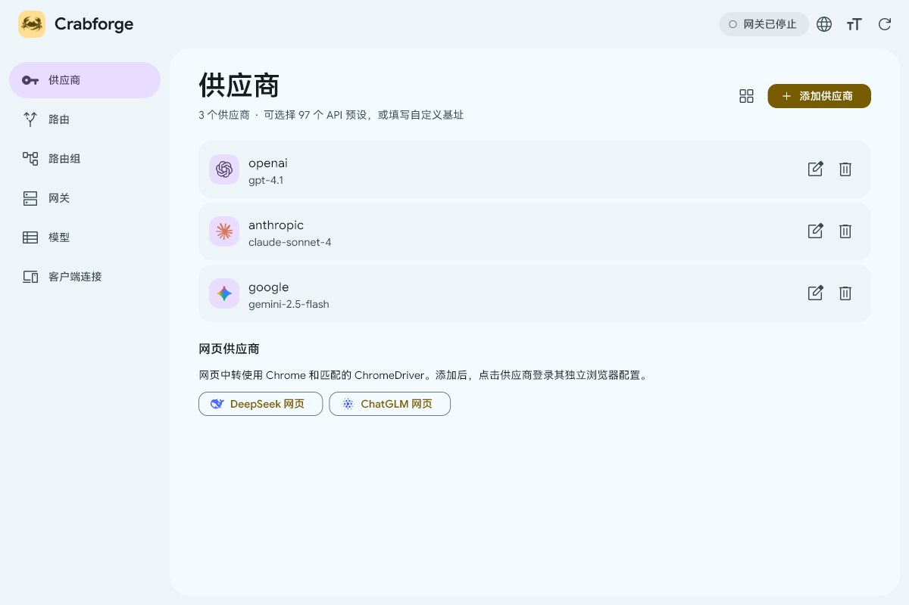
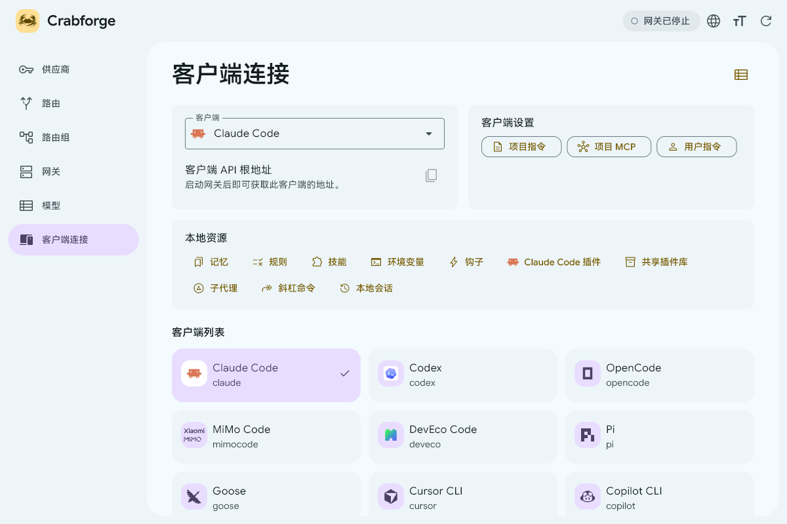
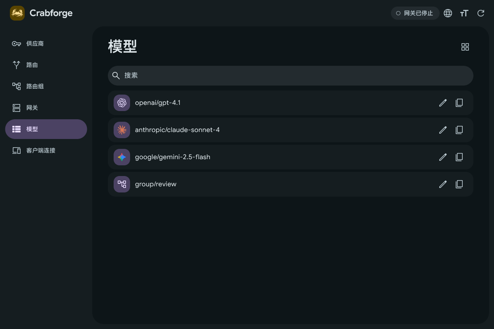

<p align="center"></p>

<h1 align="center">Crabforge</h1>

<p align="center">面向 AI 客户端的本地模型网关与 Windows 桌面控制台。</p>

<p align="center">
  <a href="https://github.com/blueokanna/Crabforge/releases/latest">下载 Windows x64 版</a> ·
  <a href="docs/windows-release.md">验证下载</a> ·
  <a href="README.md">English</a>
</p>



*截图来自当前源码构建的 Windows 桌面端，使用示例供应商和模型。Windows `v0.1.0` 下载包采用较早的界面布局。*

在「供应商」中配置上游模型，在「路由组」中为客户端提供固定的模型 ID，再到「路由」查看网关的请求尝试记录。客户端使用同一个本地网关地址，上游连接由 Crabforge 统一管理。Flutter 桌面端和命令行工具共用 Rust 核心和配置。

## 快速开始

1. 从同一发行版下载 Windows x64 ZIP 及对应的 `.sha256` 文件。按指南验证后完整解压，运行 `desktop\crabforge.exe`，并保留同目录的 DLL 与 `data` 文件夹。[发行版](https://github.com/blueokanna/Crabforge/releases) · [验证指南](docs/windows-release.md)
2. 在启动 Crabforge 的进程环境中设置上游 API 密钥。打开「供应商 → 添加供应商」，选择预设或填写 API 地址，在「API 密钥环境变量」中填入变量名，并选择或填写至少一个模型。
3. 在「网关」中点击「启动网关」，再点击「复制客户端密钥」。如果没有修改监听地址，兼容 OpenAI 的客户端使用 `http://127.0.0.1:3425/v1`。填入刚才复制的客户端密钥，并在「模型」页复制要使用的模型 ID。

ZIP 根目录包含 `crabforge-cli.exe` 和 `carbforge-cli.exe`，两者提供相同的命令。也可以在能读取上游凭据的终端中运行 `./crabforge-cli.exe serve`。随后在解压目录另开一个 PowerShell 窗口，向默认地址的网关查询模型列表。

```powershell
$gatewayKey = (./crabforge-cli.exe key).Trim()
Invoke-RestMethod -Uri 'http://127.0.0.1:3425/v1/models' `
  -Headers @{ Authorization = "Bearer $gatewayKey" } |
  Select-Object -ExpandProperty data |
  Select-Object -ExpandProperty id
```

网关的 HTTP 服务监听回环地址。浏览器客户端跨源连接时，需将其来源加入允许列表。请求使用远程供应商时，网关会将请求数据转发给该供应商。Windows 上的配置和网关密钥默认存放在 `%LOCALAPPDATA%\com.blue.crabforge`。如需使用独立配置，可将 `CRABFORGE_HOME` 设为绝对路径，或为 CLI 指定 `--data-dir`。

## 供应商、模型与路由

| 使用场景 | 操作方式 |
| --- | --- |
| 连接上游 | 通过预设添加供应商，或填写自定义 API 地址。在「模型」页搜索和复制桌面目录中的模型 ID。 |
| 用一个模型 ID 调度多个上游 | 创建路由组，选择顺序回退、轮询、加权或手动选择。路由组可设置请求匹配规则、首段内容超时和重试时限。 |
| 查看请求的去向 | 在「路由」查看当前网关进程的近期尝试记录，包括模型、供应商和结果。 |
| 在不同安装之间迁移配置 | 使用 `import-backup` 从支持的加密备份中选择要导入的条目，或用 `group share` 和 `group import` 导出和导入路由组。 |

网关提供 OpenAI Chat Completions、Responses、Anthropic Messages 和 Gemini Developer API 接口，可按原生协议转发请求，也可在这些协议之间转换受支持的生成请求。语音、图像和决策请求取决于所配置的供应商、接口和模型。[操作手册](CRABFORGE.md)

当前源码新增视频接口。用 `POST /v1/videos` 创建任务，用 `GET /v1/videos/{id}` 查询状态，用 `GET /v1/videos/{id}/content` 流式下载已完成的视频。请求可选用网关目录中的视频模型或路由组。Crabforge 支持 OpenAI 兼容的视频接口、火山方舟 Seedance、xAI Grok Imagine Video、MiniMax H3，以及 DashScope 的 Wan 3.0 和 HappyHorse 1.1。自定义 OpenAI 兼容供应商可在模型的 `native_endpoints` 中声明 `/v1/videos`。保留数据目录、上游端点和凭据，即可在重启后继续查询任务。下载支持 HTTP `Range`。

在当前源码构建的版本中，可在支持的供应商卡片上打开「订阅用量」，或运行 `crabforge-cli provider usage <id>` 或 `carbforge-cli provider usage <id>`。查询使用为该供应商配置的密钥环境变量，返回供应商报告的用量窗口、重置时间及余额。支持 OpenCode Go、智谱和 Z.ai、Kimi Code、Command Code、MiniMax、Ollama Cloud 及 Mistral Vibe。

当前源码支持刷新可发现的上游模型目录。可在供应商编辑页设置至少 `10m` 的刷新间隔，或设为 `off`，仅手动刷新。**Remote Gateway** 默认每十分钟刷新一次。对于已启用目录管理的供应商，卡片上的「读取模型目录」会更新已保存的列表。网关可在运行中应用目录更新。

自动纳入规则每行一条，用于选择新发现的模型。可用 `gpt-*` 这类不区分大小写的通配规则，或用 `re:` 开头的正则表达式匹配完整模型 ID。只要模型仍在上游列表中，手动取消选择就会继续生效，除非新增规则匹配该模型。`crabforge-cli provider` 提供 `refresh-every`、`auto-include` 和 `refresh` 子命令。

## 桌面界面与客户端



*客户端连接页的网格视图。选择客户端后可查看相应设置，启动网关后即可获取 API 根地址。*



*深色模式下的模型目录。可在同一页面搜索供应商模型与路由组，并复制模型 ID。*

桌面端采用 Material 3 Expressive 配色与 Material Symbols Rounded 图标，跟随 Windows 强调色及系统的浅色、深色和高对比度设置。客户端和供应商预设在有对应素材时显示品牌图标。选择 Google Sans 时，汉字由 HarmonyOS Sans SC 渲染。选择 HarmonyOS Sans SC 时，英文和中文均使用该字体。[字体来源与许可证](assets/fonts/manifest.json)

- **Antigravity CLI。** 安装 `agy` 并将其加入 `PATH`。启动网关后，在项目目录运行 `crabforge-cli agent antigravity '<模型-ID>'`，填入从「模型」页复制的 ID。请将 `crabforge-cli` 加入 `PATH`，或用完整路径调用。启动器通过 Antigravity 的 Gemini API 密钥模式，为当前会话传入网关密钥和地址。[Antigravity 指南](docs/antigravity.md#简体中文)
- **自动提炼记忆。** 在当前源码构建的版本中，打开「客户端连接 → 本地会话 → 自动提炼记忆」，选择模型路由和回溯天数。该功能默认关闭。网关运行时，定时任务每小时最多尝试处理 30 个符合条件且至少 30 分钟未更新的会话。任务将用户消息发送到所选路由，生成的候选记忆可在「记忆」中审核。命令行帮助见 `crabforge-cli memory distillation --help`。
- **每日发布记忆。** 在当前源码构建的版本中，打开 Claude Code 或 Codex 的「用户指令」并启用「每日发布记忆」。网关运行时会刷新生效的全局和 Agent 记忆摘要。手动修改已发布的区块或切换指令文件后，重新加载并启用以确认目标。`crabforge-cli memory agent-instructions <claude|codex>` 支持 `--auto-publish` 和 `--stop-auto-publish`。
- **夜间整理记忆。** 在当前源码构建的版本中，打开「客户端连接 → 本地会话 → 夜间整理记忆」并选择模型路由。启用后，网关会在本地时间凌晨 3 点后开始整理。它将已保存的记忆发送到所选路由，以识别重复或过时的条目，并归档超过 30 天未审核的提炼候选。手写和置顶记忆受到保护。可用「撤销上次整理」恢复修订仍匹配的条目。两个 CLI 都支持 `memory tidy` 子命令。
- **WebDAV 记忆同步。** 在当前源码构建的版本中，打开「客户端连接 → 记忆 → WebDAV 记忆同步」，填入已有目录或完整备份地址，然后预览并应用。使用目录时，文件名为 `crabforge.crabforge-backup`。共用既有 Magpie 备份时，填写以 `magpie/magpie.magpie-backup` 结尾的完整地址及其口令。本地记忆或远端备份发生变更时须重新预览。回环数字地址以外使用 HTTPS，更新远端备份需要服务端支持带强 ETag 的条件写入。双 CLI 均可先运行 `memory sync <url>`，再以返回的修订运行 `memory sync <url> --apply <revision>`。Basic 认证使用 `--user <名称> --password-env <变量>`。备份加密口令由终端提示或标准输入首行读取。

## 从源码构建

Windows 构建工作流固定使用 Rust `1.99.1` 和 Flutter `3.47.9`。请安装 Visual Studio 的「使用 C++ 的桌面开发」工作负载及 Windows SDK，再从仓库根目录执行以下命令。桌面程序生成在 `gui/build/windows/x64/runner/Release/`。[Windows CI](.github/workflows/windows-build.yml)

```powershell
cargo fmt --all -- --check
cargo clippy --locked --workspace --all-targets -- -D warnings
cargo test --locked --workspace
cargo build --locked --release --package crabforge-cli
Set-Location gui
flutter pub get --enforce-lockfile
flutter analyze --no-pub
flutter test --no-pub
flutter build windows --release --no-pub
```

Crabforge 源码采用 PolyForm Perimeter License 1.0.0。第三方组件与资源适用各自的许可条款。[项目许可证](LICENSE) · [第三方许可证](licenses/)
